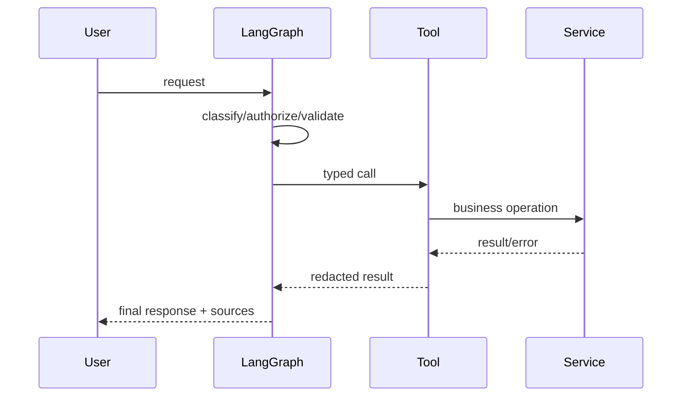

# Agent workflows

Test scenarios: event search returns filters; event creation rejects USER and asks confirmation for ADMIN if destructive; registration handles full/duplicate/concurrent cases; cancellation requires confirmation; policy question cites evidence; hybrid search + policy performs bounded search then retrieval; unauthorized tool request is refused; ambiguous destructive request asks a clarifying confirmation.

