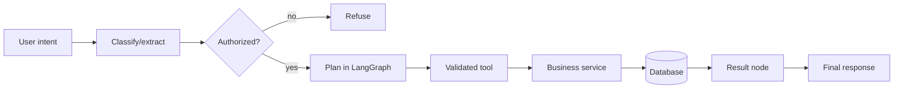

# Agent architecture

LangGraph owns state, routing, retries and checkpoints. Tools are narrow adapters. Services enforce authorization again, validate domain invariants and transact. Confirmation is required before cancellation or other destructive state changes.

