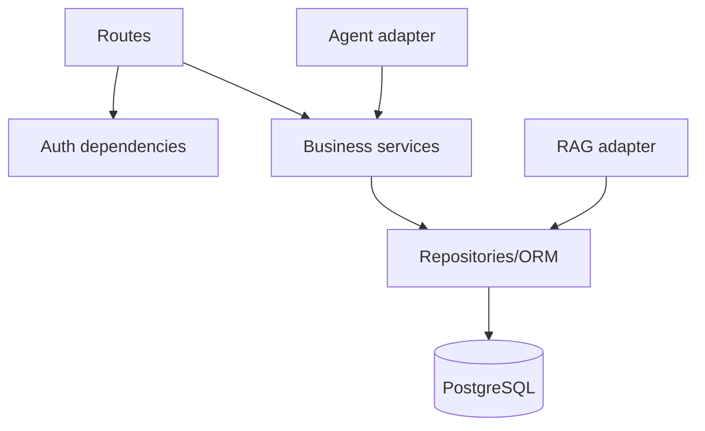

# Backend architecture

FastAPI routes own HTTP contracts and dependency injection. Core owns settings, JWT and logging. Services own business rules and transactions. Repositories/SQLAlchemy own persistence. Schemas are Pydantic request/response types. Agent and RAG adapters call services and retrieval interfaces, never tables directly.

