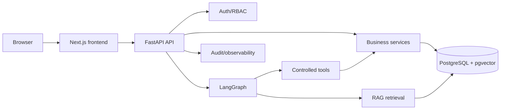
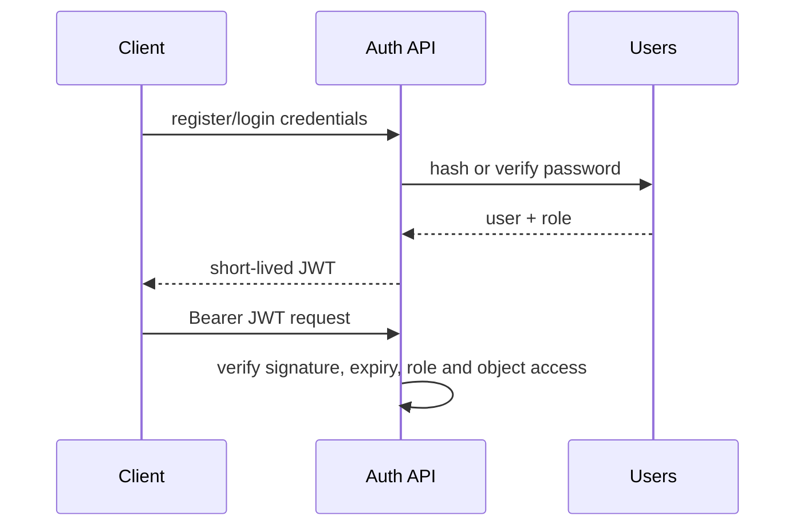
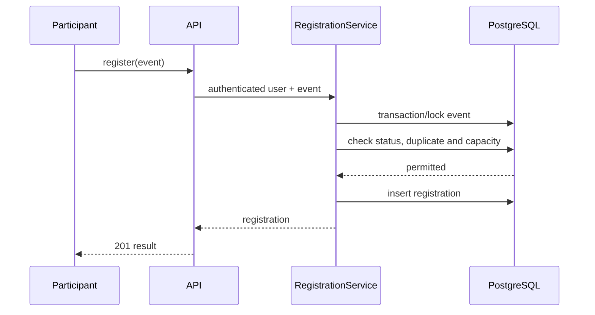
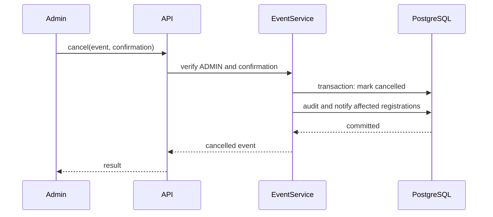

# System architecture

The system is a monorepo with a browser, API boundary, business services, persistence, agent orchestration and retrieval. The enforced path is **LLM → LangGraph → controlled tools → business services → database**. The LLM never connects to PostgreSQL.

## Authentication flow

## Event registration workflow

## Event cancellation workflow

